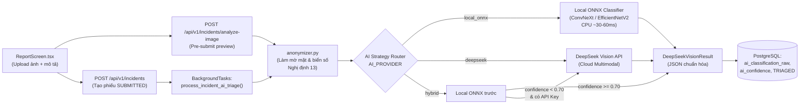

# Phân tích Kiến trúc AI, Tính khả thi Tự huấn luyện Model & Tài liệu Bàn giao (DATN — Urban Incident Management Platform)

> **Mục đích tài liệu:** Trả lời 4 câu hỏi cốt lõi phục vụ bảo vệ Đồ án Tốt nghiệp (ĐATN):
> 1. **Tính khả thi** của việc tự xây dựng & huấn luyện model AI (Local ONNX) song song với DeepSeek Vision API (làm phương án dự phòng/thẩm định).
> 2. **Bản đồ AI trong mã nguồn hiện tại**: AI nằm ở đâu, làm chính xác những việc gì, nhận đầu vào/đầu ra gì.
> 3. **Quy trình End-to-End** để thu thập dữ liệu, huấn luyện, đánh giá khoa học và nhúng model vào hệ thống.
> 4. **Prompt bàn giao chi tiết (Copy-Paste Ready)** để giao toàn bộ module AI cho thành viên nhóm (hoặc AI agent của bạn đó) triển khai đúng kiến trúc của repo.

---

## 1. Đánh giá tính khả thi & Giá trị trước Hội đồng ĐATN

### Kết luận: **RẤT KHẢ THI (Khuyến nghị mạnh nên làm)**

Trong đồ án tốt nghiệp ngành CNTT/AI, hội đồng thường đánh giá **rất cao** việc sinh viên tự thu thập/chuẩn hóa tập dữ liệu thực tế, tự huấn luyện (Transfer Learning / Fine-tuning), đo lường thực nghiệm (Confusion Matrix, Macro-F1, Latency) và tối ưu triển khai thực tế (ONNX CPU), thay vì chỉ gọi một API đóng gói sẵn như DeepSeek/OpenAI.

Tuy nhiên, **không nên bỏ hẳn DeepSeek Vision API**, mà nên thiết kế theo kiến trúc **Hybrid / Multi-Provider (`local_onnx` | `deepseek` | `hybrid`)**:
- **Model tự train (`local_onnx`)** đóng vai trò **Primary Engine**: chạy nội bộ ngay trên CPU của backend FastAPI, tốc độ nhanh (~25–60ms/ảnh), chi phí **\$0**, hoạt động **100% offline** (không lo hết quota hay rớt mạng khi demo bảo vệ), và không gửi ảnh hiện trường ra máy chủ bên thứ ba (tối ưu bảo mật theo **Nghị định 13/2023/NĐ-CP**).
- **DeepSeek Vision API (`deepseek`)** đóng vai trò **Alternative / Fallback Engine** (chế độ `hybrid`): khi model tự train có độ tin cậy thấp (`confidence < 0.70` — ví dụ ảnh mờ, sự cố hiếm gặp) hoặc cần sinh mô tả hiện trường chi tiết bằng ngôn ngữ tự nhiên, hệ thống tự động gọi DeepSeek thẩm định lại (nếu có `DEEPSEEK_API_KEY`).

### Bảng so sánh giá trị kỹ thuật & bảo vệ đồ án

| Tiêu chí | Chỉ dùng DeepSeek Vision API | Tự train Model (`ONNX`) + Hybrid DeepSeek |
| :--- | :--- | :--- |
| **Điểm đánh giá học thuật (Hội đồng)** | Trung bình (dễ bị hỏi *"gọi API thì hàm lượng AI của em ở đâu?"*) | **Rất cao** (có Dataset, Pipeline train, Ablation Study, Confusion Matrix, Latency Benchmark) |
| **Độ trễ phản hồi (Pre-submit `/analyze-image`)** | 1.5 – 4.5 giây (phụ thuộc mạng & server DeepSeek) | **25 – 60 ms** trên CPU (mượt gần như tức thì) |
| **Chi phí vận hành & Rủi ro khi demo** | Tốn token API, dễ lỗi timeout/hết quota lúc bảo vệ | **Miễn phí hoàn toàn**, chạy offline ổn định |
| **Tuân thủ Nghị định 13/2023/NĐ-CP** | Phải truyền ảnh ra ngoài Internet (dù đã làm mờ) | **Dữ liệu nằm hoàn toàn on-premise** |
| **Phần cứng huấn luyện cần thiết** | Không cần | **Google Colab Free (T4 GPU) hoặc Kaggle (P100/T4x2)** — train 15–30 phút/lần |
| **Dung lượng cài đặt trên Backend Server** | Nhẹ | Nhẹ (~30MB cho `onnxruntime` CPU + ~15–110MB file `.onnx`; **KHÔNG** cài PyTorch lên backend) |

---

## 2. Phân tích AI nằm ở đâu & Làm những việc gì trong hệ thống

Hiện tại, AI & Thị giác máy tính (Computer Vision) trong mã nguồn `d:\HK10\DATN` đảm nhận **2 nhóm nhiệm vụ chính**, đi qua **2 luồng thực thi** (Đồng bộ Pre-submit và Bất đồng bộ Background Auto-Triage).

### 2.1. Bản đồ vị trí mã nguồn AI hiện tại

| Thành phần | Đường dẫn chính xác trong repo | Vai trò & Trách nhiệm |
| :--- | :--- | :--- |
| **1. Phân loại & Điều phối sự cố (Core AI)** | `backend/app/services/deepseek_vision.py` | Entrypoint `classify_incident_image(...)` trả về `DeepSeekVisionResult`. Nếu có `DEEPSEEK_API_KEY` thì gọi DeepSeek Multimodal API; nếu chưa có thì chạy fallback OpenCV (`_analyze_image_visual_features`) hoặc luật từ khóa tiếng Việt (`_heuristic_classify`). |
| **2. Ẩn danh quyền riêng tư (Nghị định 13)** | `backend/app/services/anonymizer.py` | Entrypoint `anonymize_image(input_path, output_path)` phát hiện khuôn mặt & biển số xe, làm mờ bằng `cv2.GaussianBlur` trước khi lưu ảnh công khai (`BEFORE_ANONYMIZED`) và trước khi gửi ảnh đi phân tích. Hiện đang dùng OpenCV Haar Cascades (best-effort, dễ bỏ sót mặt nghiêng và biển số 2 dòng Việt Nam). |
| **3. API Phân tích tức thì (Pre-submit)** | `backend/app/api/v1/endpoints/incidents.py` (`POST /api/v1/incidents/analyze-image`) | Nhận ảnh + mô tả từ màn hình gửi phản ánh `/report`, áp dụng rate-limit (`ANALYZE_IMAGE_RATE_LIMIT_PER_MINUTE=10`), làm mờ ảnh vào thư mục tạm, gọi `classify_incident_image()`, xóa ảnh tạm trong `finally`, trả về `IncidentAnalyzeImageOut` (category, priority, unit, SLA, summary, hazard, số mặt/biển số đã làm mờ). |
| **4. Luồng Auto-Triage chạy nền** | `backend/app/api/v1/endpoints/incidents.py` (`process_incident_ai_triage`, dòng 266+) | Được kích hoạt qua FastAPI `BackgroundTasks` sau khi người dân nộp phản ánh (`POST /api/v1/incidents`). Chạy `anonymize_image()` -> `classify_incident_image()`, lưu `ai_classification_raw` (JSONB), `ai_confidence`, cập nhật `category_id`, `priority`, `assigned_department_id`, `sla_due_at`, chuyển trạng thái `SUBMITTED -> TRIAGED` và ghi `IncidentHistory`. |
| **5. Cấu hình môi trường** | `backend/app/core/config.py` | Quản lý `DEEPSEEK_API_KEY`, `DEEPSEEK_BASE_URL`, `DEEPSEEK_VISION_MODEL` (mặc định `deepseek-flash`). Đây là nơi sẽ bổ sung `AI_PROVIDER`, `LOCAL_AI_MODEL_PATH`, `AI_CONFIDENCE_THRESHOLD`, `ANONYMIZER_PROVIDER`. |
| **6. Kiểm thử tự động** | `backend/tests/test_deepseek_vision.py` | 17 unit tests kiểm tra contract của `classify_incident_image`, chuẩn hóa JSON, fallback, và mock HTTP (tuyệt đối không gọi API thật khi chạy `pytest`). |
| **7. Giao diện người dùng (Frontend)** | `frontend/src/screens/ReportScreen.tsx` & `CommandCenterScreen.tsx` | `ReportScreen` gọi `POST /api/v1/incidents/analyze-image` khi người dân tải ảnh lên để hiển thị thẻ gợi ý AI (`AiSuggestCard`). `CommandCenterScreen` hiển thị kết quả AI gợi ý để Điều phối viên xác nhận/chỉnh sửa trước khi giao việc. |

### 2.2. Luồng dữ liệu AI tổng thể (Dataflow)



### 2.3. Hợp đồng dữ liệu (Contract) BẮT BUỘC phải giữ nguyên

Mọi model tự train khi tích hợp vào backend **phải trả về đúng `DeepSeekVisionResult`** (hoặc đổi tên tổng quát `IncidentVisionResult` có alias ngược về `DeepSeekVisionResult` để không vỡ code cũ):

```python
class DeepSeekVisionResult(TypedDict):
    category_code: str              # Bắt buộc thuộc 6 lớp: ROAD_DAMAGE | FLOODING | FALLEN_TREE | GARBAGE | STREETLIGHT | OTHER
    priority: str                   # Bắt buộc thuộc 4 mức: LOW | NORMAL | HIGH | EMERGENCY
    suggested_department_code: str  # Bắt buộc thuộc 7 đơn vị: SGTVT_DN | CTN_DN | CCX_DN | CMT_DN | CCS_DN | UBND_HC | UBND_TK
    summary_vi: str                 # Tóm tắt tiếng Việt ngắn gọn
    hazard_warning: str | None      # Cảnh báo nguy hiểm (nếu có)
    confidence: float               # Xác suất Softmax [0.0, 1.0]
```

**Bảng ánh xạ mặc định (Domain Mapping tại Đà Nẵng):**

| `category_code` | Ý nghĩa thực tế | `suggested_department_code` mặc định | SLA mặc định theo Priority |
| :--- | :--- | :--- | :--- |
| `ROAD_DAMAGE` | Ổ gà, nứt vỡ, sụt lún mặt đường, nắp hố ga hỏng | `SGTVT_DN` (Sở Giao thông Vận tải) | `EMERGENCY`: 4h |
| `FLOODING` | Ngập úng cục bộ, nghẹt cống thoát nước | `CTN_DN` (Công ty Thoát nước) | `HIGH`: 12h |
| `FALLEN_TREE` | Cây xanh ngã đổ, cành gãy chắn đường | `CCX_DN` (Công ty Công viên Cây xanh) | `NORMAL`: 24h |
| `GARBAGE` | Rác thải tồn đọng, bãi rác tự phát | `CMT_DN` (Công ty Môi trường Đô thị) | `LOW`: 48h |
| `STREETLIGHT` | Đèn đường tắt, cột đèn nghiêng/hỏng | `CCS_DN` (Công ty Quản lý Vận hành Đèn chiếu sáng) | — |
| `OTHER` | Sự cố đô thị khác / ảnh không rõ | `UBND_HC` / `UBND_TK` (UBND Quận phụ trách) | — |

---

## 3. Đề xuất Kiến trúc Model Tự Train tối ưu cho ĐATN

Để cân bằng giữa **độ chính xác cao**, **thời gian làm hợp lý (2–4 tuần)** và **giá trị học thuật mạnh**, nên chia làm **2 hạng mục** (1 bắt buộc, 1 nâng cao ăn điểm tối đa):

### Hạng mục A (Bắt buộc — Cốt lõi): Model Phân loại Sự cố & Mức độ khẩn cấp (Multi-Task Vision Classifier)
- **Backbone khuyến nghị (chọn 1 trong 3 từ thư viện `timm`):**
  1. **`convnext_tiny.fb_in22k_ft_in1k`** (Khuyên dùng số 1): Kiến trúc hiện đại (2022), độ chính xác rất cao trên ảnh hiện trường ngoài trời, file ONNX ~110MB, inference CPU ~55ms.
  2. **`tf_efficientnetv2_s.in21k_ft_in1k`** (Cân bằng tốc độ/chính xác): File ONNX ~82MB, inference CPU ~40ms.
  3. **`mobilenetv3_large_100`** (Siêu nhẹ nếu máy demo yếu): File ONNX ~20MB, inference CPU ~15ms.
- **Kiến trúc Multi-Task (2 đầu ra trên cùng 1 Backbone):**
  - **Head 1 (`category_logits`):** 6 lớp (`ROAD_DAMAGE`, `FLOODING`, `FALLEN_TREE`, `GARBAGE`, `STREETLIGHT`, `OTHER`) — dùng `CrossEntropyLoss` (có `class_weight` nếu mất cân bằng dữ liệu + `label_smoothing=0.05`).
  - **Head 2 (`priority_logits`):** 4 mức (`LOW`, `NORMAL`, `HIGH`, `EMERGENCY`) — dự đoán mức độ nghiêm trọng dựa trên mức độ ngập/đổ/hư hại trong ảnh.
  - **Kết hợp với mô tả văn bản (Text Fusion nhẹ — tùy chọn):** Nếu người dân có nhập `description` tiếng Việt (vd: *"ngập sâu ngang yên xe, nguy hiểm"*), kết hợp xác suất ảnh với bộ luật từ khóa (`_heuristic_classify`) hoặc mô hình **TF-IDF + LogisticRegression** (nhẹ <2MB) để hiệu chỉnh `priority` lên `HIGH`/`EMERGENCY` và sinh `summary_vi` + `hazard_warning` tự nhiên.

### Hạng mục B (Nâng cao — Điểm cộng rất lớn với Hội đồng): Nâng cấp Làm mờ Nghị định 13 bằng YOLOv8n ONNX
- Hiện tại `backend/app/services/anonymizer.py` dùng **Haar Cascade** (công nghệ năm 2001), trong docstring đã ghi rõ hạn chế: dễ bỏ sót khuôn mặt góc nghiêng và biển số xe máy/ô tô 2 dòng của Việt Nam.
- **Giải pháp:** Fine-tune **YOLOv8n** (nano, siêu nhẹ ~12MB ONNX) với 2 lớp: `face` và `vn_license_plate` (có rất nhiều dataset miễn phí trên Roboflow Universe cho biển số Việt Nam + WIDER FACE).
- Chạy qua `onnxruntime` trong `anonymizer.py` (có fallback về Haar Cascade nếu thiếu file weights), sau đó so sánh Recall phát hiện mặt/biển số giữa **Haar Cascade vs YOLOv8n** trong báo cáo ĐATN -> **Điểm cộng cực lớn về tính thực tiễn và tuân thủ pháp luật Việt Nam**.

---

## 4. Quy trình 6 bước để Huấn luyện, Đánh giá & Triển khai AI

### Bước 1: Tổ chức thư mục `ml/` tách biệt hoàn toàn khỏi `backend/`
Không cài PyTorch/Ultralytics vào `backend/requirements.txt` (sẽ làm Docker image phình lên >3GB). Thay vào đó tạo thư mục `ml/` ở gốc repo:

```text
d:\HK10\DATN\
├── backend/
│   ├── app/services/
│   │   ├── ai_classifier.py        # [MỚI] Router Strategy: local_onnx | deepseek | hybrid
│   │   ├── local_onnx_vision.py    # [MỚI] ONNX Runtime CPU inference (chạy qua asyncio.to_thread)
│   │   ├── deepseek_vision.py      # [GIỮ NGUYÊN] Provider DeepSeek + Heuristic fallback
│   │   └── anonymizer.py           # [NÂNG CẤP] Hỗ trợ YOLOv8n ONNX + fallback Haar Cascade
│   └── weights/                    # (gitignored, chỉ giữ README hướng dẫn tải file .onnx)
│       ├── incident_classifier.onnx
│       ├── incident_classifier_meta.json
│       └── decree13_yolov8n.onnx   # (tùy chọn Hạng mục B)
└── ml/                             # [MỚI] Toàn bộ code thu thập, train, eval
    ├── requirements-train.txt      # torch, timm, albumentations, scikit-learn, onnx, onnxruntime
    ├── data/                       # (gitignored) raw/, processed/, metadata.csv
    ├── configs/                    # train_config.yaml
    ├── src/
    │   ├── prepare_dataset.py      # Làm sạch, kiểm tra ảnh lỗi, chia Stratified 70/15/15
    │   ├── dataset.py              # PyTorch Dataset + Albumentations
    │   ├── model.py                # Multi-task ConvNeXt/EfficientNetV2
    │   ├── train.py                # Vòng lặp train + Mixed Precision (AMP) + Early Stopping
    │   ├── evaluate.py             # Tính Macro-F1, Confusion Matrix, Latency Benchmark
    │   └── export_onnx.py          # Xuất .onnx + kiểm tra sai số < 1e-4 so với PyTorch
    └── notebooks/
        └── colab_train_incident_ai.ipynb
```

### Bước 2: Thu thập & Chuẩn hóa Tập dữ liệu (Dataset)
- **Quy mô khuyến nghị cho ĐATN:** Tối thiểu **300–500 ảnh/lớp** -> tổng **1.800–3.000 ảnh** cho 6 lớp.
- **Nguồn dữ liệu kết hợp (Public + Thực địa Đà Nẵng):**
  - `ROAD_DAMAGE`: Bộ dữ liệu **RDD2022** (Road Damage Dataset — có dữ liệu đường châu Á/Việt Nam) + ảnh ổ gà/lún đường thực tế.
  - `FLOODING`: **FloodNet** / Kaggle Urban Flooding + ảnh ngập lụt đường phố Đà Nẵng (Google Images / báo chí địa phương đã lọc sạch watermark).
  - `FALLEN_TREE`: Kaggle Fallen Trees / Storm Damage + ảnh cây đổ sau bão.
  - `GARBAGE`: **TACO** (Trash Annotations in Context) / Kaggle Garbage Street + ảnh rác thải đô thị.
  - `STREETLIGHT`: Roboflow Broken Streetlight / Night Streetlight + ảnh trụ đèn đường.
  - `OTHER`: Ảnh đường phố bình thường, vỉa hè, sự cố khác (dây điện võng, biển báo gãy, ảnh nhiễu) để model biết phân biệt khi không thuộc 5 nhóm trên.
- **Chuẩn hóa nhãn (`ml/data/metadata.csv`):**
  ```csv
  image_path,category_code,priority,source,split
  images/road_001.jpg,ROAD_DAMAGE,HIGH,rdd2022,train
  images/flood_014.jpg,FLOODING,EMERGENCY,danang_field,val
  ```
- **Kiểm soát chất lượng:** Xóa ảnh trùng lặp bằng perceptual hash (`imagehash`), xóa ảnh hỏng/0 byte, đảm bảo không rò rỉ dữ liệu (data leakage) giữa `train` và `test`.

### Bước 3: Tiền xử lý & Tăng cường dữ liệu (Data Augmentation)
Sử dụng `albumentations` mô phỏng đúng điều kiện chụp ảnh điện thoại ngoài trời tại Đà Nẵng:
- `RandomResizedCrop(224, 224)` hoặc `(256, 256)`
- `HorizontalFlip(p=0.5)`
- `RandomBrightnessContrast(p=0.4)` (nắng gắt miền Trung & ban đêm)
- `RandomRain(p=0.15)` / `MotionBlur(p=0.15)` (mưa bão, người đi đường chụp vội rung tay)
- `ImageCompression(quality_range=(50, 95), p=0.3)` (ảnh nén qua Zalo/Messenger/4G)
- Chuẩn hóa theo ImageNet mean/std: `mean=(0.485, 0.456, 0.406)`, `std=(0.229, 0.224, 0.225)`.

### Bước 4: Huấn luyện (Transfer Learning trên Google Colab / Kaggle)
1. **Giai đoạn 1 (Warm-up — 3–5 epochs):** Freeze backbone, chỉ train 2 classification heads với `lr=1e-3`, `AdamW`.
2. **Giai đoạn 2 (Fine-tuning — 15–25 epochs):** Unfreeze toàn bộ mạng, `lr=1e-4` (backbone `1e-5`, heads `1e-4`), `CosineAnnealingLR`, `weight_decay=1e-2`, bật `torch.cuda.amp.autocast()` để train nhanh gấp đôi.
3. **Loss tổng hợp:**
   $$\mathcal{L}_{total} = 1.0 \cdot \mathcal{L}_{CE}(\text{category}) + 0.4 \cdot \mathcal{L}_{CE}(\text{priority})$$
4. **Lưu checkpoint tốt nhất** theo tiêu chí **Validation Macro-F1** (không dùng Accuracy đơn thuần để tránh lệch lớp).

### Bước 5: Đánh giá khoa học (Lấy số liệu viết Chương Thực nghiệm trong Báo cáo ĐATN)
Chạy `ml/src/evaluate.py` trên tập **Test độc lập (15%)** để xuất đầy đủ các bảng biểu sau vào `docs/report/ai-evaluation/`:
1. **Classification Report:** Precision, Recall, F1-score cho từng lớp trong 6 lớp + Macro-F1 tổng.
2. **Confusion Matrix** (ảnh PNG độ phân giải cao) để phân tích các cặp dễ nhầm lẫn (vd: `ROAD_DAMAGE` vs `FLOODING` khi ổ gà chứa nước mưa).
3. **So sánh 2–3 Backbone (Ablation Study):** Ví dụ so bảng kết quả giữa `MobileNetV3-Large`, `EfficientNetV2-S`, `ConvNeXt-Tiny` (Macro-F1, kích thước file ONNX, thời gian inference trung bình trên CPU ms/ảnh).
4. **So sánh với DeepSeek Vision API (Benchmark trên 50–100 ảnh test):** So sánh Accuracy/F1, độ trễ (ms), chi phí, và tỷ lệ cải thiện khi bật chế độ `hybrid` (`local_onnx` fallback sang `deepseek` khi `confidence < 0.70`).

### Bước 6: Xuất ONNX & Tích hợp sạch vào Backend FastAPI
1. Xuất model bằng `torch.onnx.export(..., opset_version=17)` kèm file metadata `incident_classifier_meta.json` (lưu đúng thứ tự nhãn `categories`, `priorities`, `input_size`, `mean`, `std`, `model_version`).
2. Kiểm tra sai số đầu ra giữa PyTorch và ONNX Runtime (`np.max(np.abs(pt_out - ort_out)) < 1e-4`).
3. Thêm duy nhất `onnxruntime>=1.19.0` vào `backend/requirements.txt`.
4. Tạo `backend/app/services/local_onnx_vision.py`:
   - Lazy-load `onnxruntime.InferenceSession` (Singleton, chỉ load 1 lần vào RAM, không load lại mỗi request).
   - Chạy `session.run(...)` bên trong `await asyncio.to_thread(...)` để **tuyệt đối không chặn FastAPI Async Event Loop**.
5. Tạo `backend/app/services/ai_classifier.py` (Strategy Router) điều phối qua biến môi trường trong `backend/app/core/config.py`:
   - `AI_PROVIDER: Literal["local_onnx", "deepseek", "hybrid"] = "hybrid"`
   - `LOCAL_AI_MODEL_PATH: str = "weights/incident_classifier.onnx"`
   - `AI_CONFIDENCE_THRESHOLD: float = 0.70`
   - Nếu chọn `local_onnx` hoặc `hybrid` nhưng chưa có file `.onnx` trên máy -> tự động fallback an toàn về DeepSeek/Heuristic (không làm crash server).
6. Viết unit test mới `backend/tests/test_ai_classifier.py` (mock ONNX session & DeepSeek), đảm bảo **toàn bộ `py -m pytest` đều PASS** và 17 tests trong `test_deepseek_vision.py` giữ nguyên màu xanh.

---

## 5. Prompt chi tiết để bàn giao cho đồng đội (Copy-Paste Ready)

> **Hướng dẫn sử dụng:** Copy toàn bộ nội dung trong khung bên dưới gửi cho bạn cùng nhóm (hoặc dán thẳng vào công cụ AI coding như Antigravity / Cursor / Claude Code khi mở repo `d:\HK10\DATN`).

```markdown
# NHIỆM VỤ: XÂY DỰNG, HUẤN LUYỆN & TÍCH HỢP MODEL AI TỰ TRAIN (LOCAL ONNX) SONG SONG VỚI DEEPSEEK VISION API

## 1. Bối cảnh dự án
Đây là nền tảng quản lý sự cố đô thị TP. Đà Nẵng (DATN HK10):
- Backend: Python 3.11+, FastAPI, SQLAlchemy 2.0 Async, PostgreSQL 16 + PostGIS, OpenCV.
- Hiện tại, hệ thống đang dùng `backend/app/services/deepseek_vision.py` (DeepSeek Vision API + OpenCV/keyword fallback) để phân loại sự cố, và `backend/app/services/anonymizer.py` (OpenCV Haar Cascades) để làm mờ khuôn mặt & biển số xe theo Nghị định 13/2023/NĐ-CP.
- Mục tiêu: Tự xây dựng và huấn luyện một model AI phân loại sự cố đô thị (Local ONNX chạy trên CPU), tích hợp theo kiến trúc Strategy Pattern để chạy độc lập hoặc chạy song song (Hybrid) với DeepSeek Vision API, phục vụ bảo vệ trước Hội đồng ĐATN.

## 2. Yêu cầu đọc mã nguồn trước khi làm
Hãy đọc các file sau để nắm chính xác hợp đồng dữ liệu (contract) và quy ước dự án:
1. `AGENTS.md` và `.agents/rules/incident-domain-invariants.md`
2. `backend/app/services/deepseek_vision.py` (chú ý `DeepSeekVisionResult`, `DEFAULT_VALID_CATEGORIES`, `DEFAULT_VALID_DEPARTMENTS`, `VALID_PRIORITIES`, `classify_incident_image`)
3. `backend/app/services/anonymizer.py`
4. `backend/app/api/v1/endpoints/incidents.py` (chú ý `analyze_incident_image` và `process_incident_ai_triage`)
5. `backend/app/core/config.py` và `backend/requirements.txt`
6. `backend/tests/test_deepseek_vision.py`

## 3. Phạm vi công việc (Deliverables)

### Phần A — Pipeline Huấn luyện & Đánh giá trong thư mục `ml/` (tách biệt với `backend/`)
1. Tạo cấu trúc thư mục `ml/` gồm: `requirements-train.txt`, `configs/`, `src/` (`prepare_dataset.py`, `dataset.py`, `model.py`, `train.py`, `evaluate.py`, `export_onnx.py`), và `notebooks/colab_train_incident_ai.ipynb` để có thể chạy mượt trên Google Colab T4 / Kaggle GPU.
2. Xây dựng mô hình Multi-Task Transfer Learning bằng PyTorch + `timm` (mặc định hỗ trợ so sánh `convnext_tiny`, `tf_efficientnetv2_s`, `mobilenetv3_large_100`) với 2 đầu ra:
   - Head 1 (`category_code` — 6 lớp): `ROAD_DAMAGE`, `FLOODING`, `FALLEN_TREE`, `GARBAGE`, `STREETLIGHT`, `OTHER`.
   - Head 2 (`priority` — 4 mức): `LOW`, `NORMAL`, `HIGH`, `EMERGENCY`.
3. Hỗ trợ Data Augmentation bằng `albumentations` (mô phỏng trời mưa, ban đêm, rung tay, nén ảnh JPEG) và chia tập Stratified Train/Val/Test (`70/15/15`).
4. Viết script `evaluate.py` xuất ra các chỉ số phục vụ báo cáo ĐATN:
   - Precision, Recall, F1 từng lớp & Macro-F1.
   - Biểu đồ Confusion Matrix (PNG).
   - Benchmark tốc độ inference trên CPU (ms/ảnh) và kích thước file `.onnx`.
5. Viết script `export_onnx.py` xuất `incident_classifier.onnx` (`opset=17`) + `incident_classifier_meta.json`, và tự động kiểm tra sai số tối đa giữa PyTorch và ONNX Runtime (`max_abs_diff < 1e-4`).
6. (Tùy chọn nâng cao — NĐ13) Tạo thêm pipeline fine-tune `YOLOv8n` (2 lớp: `face`, `vn_license_plate`) xuất `decree13_yolov8n.onnx` để thay thế/bổ sung cho Haar Cascade trong `anonymizer.py`.

### Phần B — Tích hợp vào Backend FastAPI (Strategy / Hybrid Pattern)
1. Cập nhật `backend/app/core/config.py` và `.env.example` thêm các biến cấu hình:
   - `AI_PROVIDER: str = "hybrid"` (chấp nhận `"local_onnx"`, `"deepseek"`, `"hybrid"`)
   - `LOCAL_AI_MODEL_PATH: str = "weights/incident_classifier.onnx"`
   - `LOCAL_AI_META_PATH: str = "weights/incident_classifier_meta.json"`
   - `AI_CONFIDENCE_THRESHOLD: float = 0.70`
2. Tạo `backend/app/services/local_onnx_vision.py`:
   - Load model ONNX theo cơ chế lazy singleton (chỉ load 1 lần).
   - Tiền xử lý ảnh hỗ trợ đường dẫn Unicode trên Windows (`np.fromfile` + `cv2.imdecode`).
   - Thực thi inference qua `asyncio.to_thread(...)` để không block FastAPI event loop.
   - Trả về đúng TypedDict `DeepSeekVisionResult` (ánh xạ `category_code` -> `suggested_department_code`, sinh `summary_vi` và `hazard_warning`, kết hợp hiệu chỉnh nhẹ nếu có `description` tiếng Việt).
3. Tạo `backend/app/services/ai_classifier.py` làm điều phối trung tâm:
   - `AI_PROVIDER=local_onnx`: chạy ONNX; nếu thiếu file weights thì log warning và fallback an toàn về heuristic.
   - `AI_PROVIDER=deepseek`: gọi trực tiếp `deepseek_vision.classify_incident_image(...)`.
   - `AI_PROVIDER=hybrid`: chạy ONNX trước; nếu `confidence >= AI_CONFIDENCE_THRESHOLD` thì trả về ngay (tiết kiệm chi phí & độ trễ thấp); nếu `confidence < AI_CONFIDENCE_THRESHOLD` và có `DEEPSEEK_API_KEY` thì gọi DeepSeek Vision để thẩm định lại.
4. Cập nhật `backend/app/api/v1/endpoints/incidents.py` gọi qua `ai_classifier.classify_incident_image(...)` (giữ nguyên toàn bộ response schema `IncidentAnalyzeImageOut` và logic `process_incident_ai_triage`).
5. Thêm `onnxruntime>=1.19.0` vào `backend/requirements.txt`.

## 4. Các ràng buộc BẮT BUỘC (Non-goals & Invariants)
- **KHÔNG** cài `torch`, `torchvision`, `timm`, `ultralytics` vào `backend/requirements.txt` (chỉ để trong `ml/requirements-train.txt`).
- **KHÔNG** commit file weights `.onnx` nặng hoặc thư mục ảnh `ml/data/` lên Git (cập nhật `.gitignore` và để hướng dẫn tải weights trong `backend/weights/README.md`).
- **KHÔNG** làm hỏng contract `DeepSeekVisionResult` hoặc 17 tests hiện có trong `backend/tests/test_deepseek_vision.py`.
- **KHÔNG** gọi DeepSeek API thật hoặc yêu cầu file `.onnx` thật khi chạy `pytest` (mọi unit test phải mock sạch sẽ).
- **KHÔNG** chạy CPU inference đồng bộ trực tiếp trong async route handler (phải dùng `asyncio.to_thread`).
- **KHÔNG** sửa các module GIS/PostGIS (`zones.py`, `GoongBentoMap.tsx`, `SystemSettingsScreen.tsx`).

## 5. Tiêu chí hoàn thành (Definition of Done)
1. `py -m compileall -q backend/app` chạy sạch không lỗi.
2. `py -m pytest` (trong `backend/`) PASS 100%, bao gồm cả `test_deepseek_vision.py` (cũ) và `test_ai_classifier.py` (mới test đủ 3 chế độ `local_onnx`, `deepseek`, `hybrid`, fallback khi thiếu weights, và fallback khi `confidence < threshold`).
3. Có báo cáo kết quả huấn luyện thực nghiệm (Macro-F1, Confusion Matrix, bảng so sánh Latency CPU vs DeepSeek API) lưu tại `docs/report/ai-model-evaluation.md`.
4. Làm việc trên nhánh riêng `feat/custom-local-ai-model` theo quy chuẩn Conventional Commits.
```
